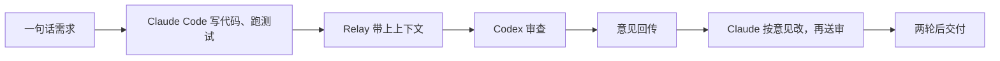

2026-10-30 · 最新速递

本文挂在 [最新速递](/tags/最新速递/)。原文写于 2026-10-25。

先讲一个我天天在经历的画面：左边终端开着 Claude Code，右边终端开着 Codex。Claude 写完一段代码，我想让 Codex 换个视角审查一下，就得手动把 diff 复制过去；Codex 提出三条意见，我再复制回来。来回几次之后，我觉得自己不是工程师，是一台人肉复制粘贴机。

如果只是我一个人这样就算了，问题是几乎所有同时在用多个 coding agent 的人都在干同一件事：在两个甚至三个终端之间搬运上下文、搬运 diff、搬运报错，还要自己记着"这个意见回给那边了没有"。工具越来越强，人却成了它们之间唯一的通信协议。

直到我看到有人实测了一个叫 Agent Relay 的开源项目：只发一句话，Claude Code 写完代码直接呼叫 Codex 审查，两个 AI 自己在后台 battle 两轮，最后把产品完整交付。人全程只说了那句话，和最后验收。这篇文章就是把这个项目和这次实测拆开讲讲。

## Agent Relay 是什么

一句话：它是让多个 AI agent 直接对话的通信层，而不是又一个 harness。官网自己的定位是 "Your agents should talk to each other, just not through you"——你的 agents 应该互相说话，只是别通过你。

为什么需要这个东西？因为多 agent 协作里最麻烦的往往不是模型能力，而是"怎么把话递到对方手里"。它定义了一套消息模型：channels（通道）、threads（线程）、DM 和 @mentions，agent 之间像人在同一个工作群里一样沟通，谁说了什么、为什么这么定，都留痕、可搜索。

技术上的巧妙之处在于它是基于 PTY 的驱动：不改 agent 的代码，而是接管 CLI 进程的输入输出。所以市面上几乎所有 CLI agent 都能接上——Claude Code、Codex、opencode、Cursor、Grok，甚至 Hermes、OpenClaw 这类——接入成本很低，不需要各家改接口。

它和自己写一个编排脚本的区别在于：脚本是固定流程，断一步就全断；它是运行时通道加上状态持久化，agent 中途挂了、重启、换 provider，会话和进度都还在。协作这件事，从"写死的流程"变成了"可以托管的服务"。

项目本身完全开源（Apache-2.0，GitHub 上的 AgentWorkforce/relay），官网提供托管版也有免费额度。据安利这条帖子的博主介绍，它出自 YC 系团队，最近刚发布就引起不少关注。

## 实测：一句话，两个 AI 自己 battle

整个流程比我想象的顺，拆开看其实是一条很清晰的时间线。

第一步，我只发了一句话的需求，Claude Code 接活开工：写代码、跑测试，把初版做出来。

第二步，写完那一刻，它通过 Relay 把任务连同完整的会话上下文一起打包，呼叫 Codex：你来审查。这里的关键是"上下文一起走"——不是丢一坨 diff 过来，而是带着改动的背景、范围和测试结果。

第三步，Codex 带着这些背景读代码，给出修改意见，意见原路回传。

第四步，Claude 照着意见改完，再次送审。两轮之后两边达成一致，产物交付。

整个过程中最有价值的一点是上下文跟着走。以前我在两个终端之间复制的只是片段，审查者永远缺上下文，只能就代码论代码；现在审查者能看到写代码那一方完整的会话背景，审查质量完全不在一个量级。

人的角色被压缩到了极致：只负责下指令和最后验收。同样的活如果我手动来——复制 diff、贴意见、来回协调，半小时起步，还经常漏上下文、对不上版本；现在我只说了一句话，和最后一句"可以"。

## 不只是聊天：支撑协作的硬设施

如果只是消息转发，那它不过是个玩具。Agent Relay 真正让我觉得工业可用的，是几件配套的硬设施。

第一，通道、线程与可搜索历史。协作不是把两条消息丢来丢去，而是在一个持续存在的空间里推进。它提供了 channels、threads、DM 和 @mentions，agent 之间像人在同一个工作群里一样沟通；更重要的是历史可搜索，新加入的 agent 或者人，随时能查"当时为什么这么定"，不用从头问一遍。

第二，持久化工作流。每次状态迁移都被持久化，服务重启、重新部署都不会丢进度；重试只重做失败的单个步骤，不会把已经成功的工作重复一遍，也不产生重复副作用。整个运行历史一次看全，这也是它和"临时脚本"最本质的区别。

第三，共享文件系统。它提供一套基于 REST 的虚拟文件树：外部 webhook 先进队列落库，再投影成文件树，冲突安全地写回。agent 之间可以读写同一份工件，而不是靠把文件内容贴在聊天里传来传去。

第四，实时事件流。通过 WebSocket 把通道里的状态实时推出去，第三方系统可以订阅整个协作过程——跑在 CI 里、接到自己的监控里，或者喂给另一个 agent 做决策，都能接得上。

第五，SDK 与自托管。不一定要用它的托管服务，一条 npm install @agent-relay/sdk 就能把 SDK 接进自己的 orchestrator，让自定义流程直接驱动这些通道；引擎本身也可以架在自己的基础设施里，团队要完全掌控也行。

| 设施 | 解决的事 |
|-|-|
| 通道、线程、可搜索历史 | 协作留在一个持续空间里，后来者能查当时为什么这么定 |
| 持久化工作流 | 重启不丢进度，失败只重做那一步 |
| 共享文件系统 | agent 读写同一份工件，不用把文件贴进聊天 |
| 实时事件流 | WebSocket 把过程推给 CI、监控或另一个 agent |
| SDK 与自托管 | 接到自己的 orchestrator，引擎也可以放在自己的机器上 |

## 我的几点思考

这东西和我最近在追的一条脉络正好对上。前阵子我收藏过 Salix——让 agent 自己写 eBPF 小程序去盯事件，只在值得时才唤醒大模型；也看过 Jev——用便宜的小模型先粗筛每个事件，贵的模型只处理升级上来的事。它们的共同方向是：把"人肉路由"从系统里拿掉，让 agent 之间自己分工、自己交接、自己验证。Agent Relay 把其中"agent 之间如何对话"这一环标准化了，而且落到了生产可用的程度。

这是个关键的转折点。以前多 agent 协作大多是 demo 里互相调 API 的玩具，断一步就全断，没人敢真用。现在有了通道、持久化状态和可搜索历史，协作开始变得可以运维：消息不会丢，进度不会断，出了事能回溯。工具从"能跑"走到了"能维护"。

对做 AI 应用开发的人来说，最值得抄的是它的三个工程原则。第一是审查分离：让另一个模型的 agent 审代码，而不是让写代码的模型自己审自己，不同模型的长处天然互补。第二是验收契约：任务只有在验证真正通过时才报告 pass，而不是进程退出码为 0 就算完，这对交付质量是质的区别。第三是失败接管：一个 provider 额度耗尽或超时，自动切到另一个继续干，不会整个任务跟着崩。

还有一点是团队视角的可观察性。每次委派、每轮往返都留痕，跑完可以整体复盘"当时谁做了什么决定、为什么"。这对调试和审计都很重要，多 agent 系统最难的不是写出来，是出了错能看懂。

换个角度想，这也是"AI Native 系统自进化"的一个具体切面：系统自己决定把什么任务交给谁、如何验证结果、失败怎么兜底，人只负责监督和理解。面试里聊多智能体协作，能把这套结构讲清楚，会是很扎实的加分项。

当然也要说清楚边界：它不是安全沙箱，agent 的权限还是靠各家 CLI 自己的配置；它不是任务队列或自主流水线，多步骤的规划与重试仍然需要调用方负责；并行编辑时文件所有权要自己管理好；多 agent 同时开工，token 消耗也会成倍上涨，成本要提前算清楚。工具解决的是"怎么协作"，不替你解决"干什么、怎么干对"。

## 三分钟上手

安装其实比想象中简单。官方仓库的 README 提供了一行命令的安装流程：装完 CLI 之后，它会自动探测你机器上已经装好的 Claude Code、Codex 这些工具，帮你把 skills 和 MCP server 接好，还会在本地启动一个仪表盘，全程不出本机。

第一次试，建议从最小的场景开始：让 Codex 去审查 Claude 刚写出来的 diff，只读不改。你只需要在对话里说一句"用另一个 agent 审查一下当前 diff"，剩下的事交给它自己完成委派。

跑通之后就可以玩多 agent 分工：Claude 负责写，Codex 负责审，想再看一个视角，还能拉 opencode 或者 Grok 进来，各管一段、互相 @。仪表盘上每一次委派、每一轮往返、耗时和结果都看得清清楚楚，跑完之后翻历史就能复盘当时为什么这么定。

最后说一句：两个 AI 在后台 battle 的画面，比起以前我亲手复制粘贴，才是这个时代该有的开发方式。至少，我终于不用在两个终端之间当人肉复制粘贴机了。

## 资料来源

X 实测帖 @longhaiqwe123（2026-10-24），Agent Relay 官网 agentrelay.com，GitHub 仓库 AgentWorkforce/relay。核验日期 2026-10-25。
