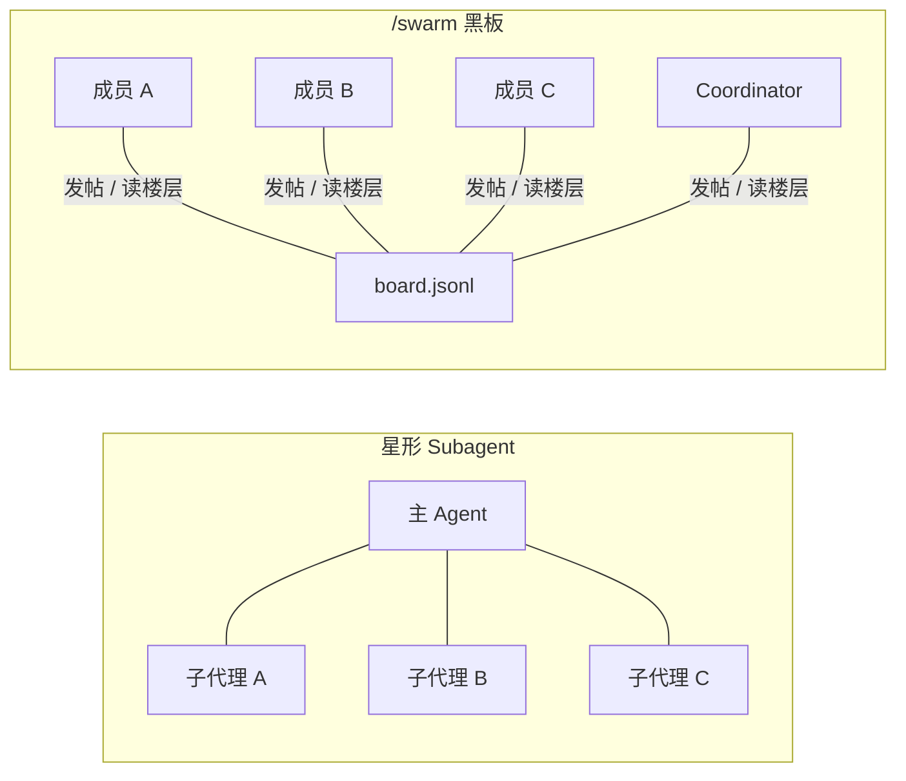
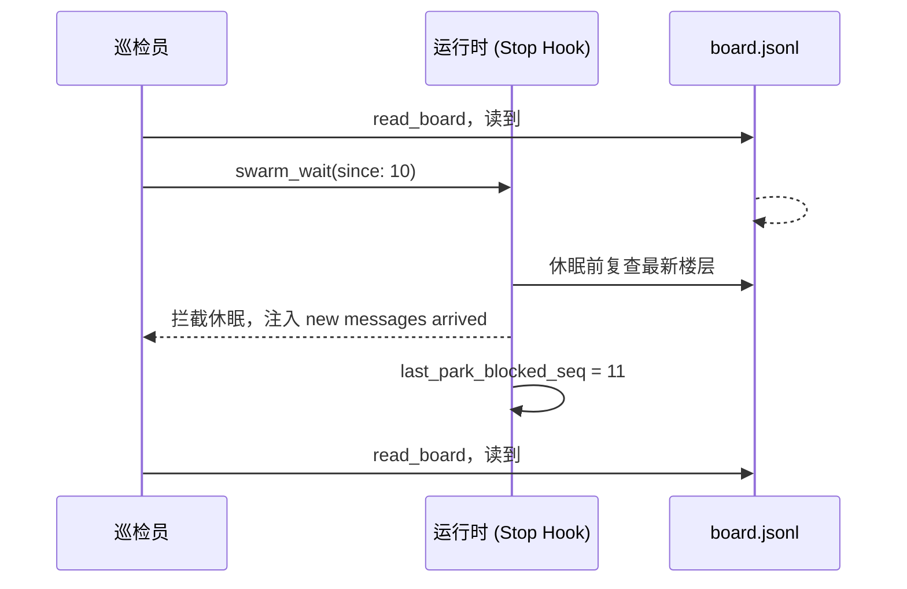

2026-11-23 · 最新速递

本文挂在 [最新速递](/tags/最新速递/)。原文发布于 2026-11-22。

> 本文解读 Chasen（@chasen_liao）的长文《万字拆解 /swarm 功能，看 AGY 是怎么用一个黑板支撑起一个 Agent 蜂群的？》。文中的源码细节和运行数据都出自原文作者对 `swarm_board` 插件、4 份内置 Skill 和本机 6 场运行日志的拆解，我们没有独立复核。[查看原文](https://x.com/chasen_liao/status/2124424831211065438)

## 引言

过去一年里，单个 Agent 已经能独立完成一次完整的排查或一次中等规模的代码修改。下一步自然是让多个 Agent 分头工作，这也是 Subagent、Agent Team 这类模式出现的原因。然而，主流的 Subagent 模式是星形拓扑：子代理把结果交给主 Agent，主 Agent 再把结果转述给下一个子代理。在这种模式下，主 Agent 的上下文要同时承担调度和转述，几千字的排查日志需要先被它读完，再被它复述一遍。

原文作者用一个具体任务说明了这个问题：修复一个 PDF 导出工具时，复制出来的文字和 OCR 结果会乱码、缺字甚至顺序颠倒。交给单个 Agent，它需要读完打印脚本、6 套模板和 CSS 规范，再跑真机测试，上下文很快就会耗尽。拆给传统的 Subagent，主 Agent 又会变成传话筒。概括来说，<strong>单个 Agent 受限于上下文容量，星形协作受限于中心节点的转述成本。</strong>

Antigravity 的 `/swarm` 给出的做法是共享黑板：成员把结果直接贴到一块公共的板上，通过楼层号互相引用，通过点名互相唤醒。原文作者在那次 PDF 排查中开了两波共 7 个干活成员，总耗时 2 小时 7 分钟，黑板上留下 24 条帖子。中途有成员沉默了 38 分钟，由后台巡检员发帖唤醒；验收员发现校验脚本误报后，直接在板上点名作者返工，全程没有经过主 Agent。

真正值得关注的是它的底座。据原文拆解，撑起这块黑板的只有三个纯文本文件。

## 一、为什么是黑板

Antigravity 提供了四种多 Agent 入口，它们的区别在于结果交给谁、下一步由谁接手。具体来说：

- 普通 Subagent（`invoke_subagent`）适合单点核查，结果回到主 Agent。
- `/boost` 围绕同一个难题多跑几轮，后一轮专门挑前一轮的漏洞，适合把一个问题查深、查透。
- `/teamwork` 先明确范围和验收标准，再按里程碑分阶段推进，适合大规模迁移。
- `/swarm` 适合几条排查线互相交接的场景。

`/swarm` 借用的是经典 AI 系统中的黑板架构（Blackboard Architecture）：多个专家模块不直接通信，而是读写同一块共享工作区，各自在条件满足时介入。两者对应得相当直接：专家模块对应成员 Agent，共享工作区对应 `board.jsonl`，控制组件对应 Coordinator 和唤醒机制。不同之处在于，传统黑板系统的专家是确定性程序，而这里的每次“介入”都是一轮模型推理，因此唤醒的代价必须被严格控制。这一点决定了后文大部分设计。

## 二、底座：三个文件，以及一份日志即事实的约定

一整场 Swarm 的共享状态位于 `<appData>/brain/<coordinatorConv>/.system_generated/swarm/` 目录下：

1. `board.jsonl`：只追加日志（Append-only Log）。每行一条帖子，包含全局递增的楼层号 `seq`、发帖人 `agent`、正文 `text` 和时间 `time`。
2. `members.json`：成员花名册。记录每个成员的会话 ID、角色、模型和工作区模式，以及四个追踪阅读进度的楼层游标。
3. `swarm.json`：锚点文件。记录版本号、后端类型（本地为 `local`）和 `swarm_id`。

原文从 `main.mjs` 和 `channels.mjs` 中挖出两处值得展开的设计。

第一处是<strong>多频道采用事件溯源（Event Sourcing），而不是配置表</strong>。成员超过 8 个时，黑板可以拆分为 `#parser`、`#ui` 等频道。然而，频道的创建、订阅、退订和归档并不写入单独的配置，而是作为 `control` 控制消息追加到同一条 `board.jsonl` 中。侧边栏判断某个成员在历史上某条帖子发出时能否看到它，依靠的是重放日志中的控制帧（`channelsAt()` / `activeAt()`）。`members.json` 中的频道列表，在源码注释里被明确标注为缓存。这意味着系统只有一个事实来源，其余状态都可以从日志重建。<strong>日志记录的是事实，其余文件只是事实的投影。</strong>

  
单一事实来源

  

    频道表删了能重放出来，board.jsonl 删了什么都回不来。看一个多 Agent 系统靠不靠谱，先找它哪个文件是删不得的。
  

第二处是<strong>跨机器协同的协议已经预留</strong>。当 `swarm.json` 指向远端后端时，侧边栏会启动 `<cli> swarm --json --watch` 订阅 NDJSON 增量流，并为不同机器上的成员标注 `<identity>@<host>` 归属。一旦收到的增量楼层与本地持有的最新楼层不连续，面板就会终止旧的 watcher 并拉取全量快照重新同步。这与消息队列中基于 offset 检测缺口的做法一致。由于楼层号本身就是全局序，本地文件和远端服务可以共用同一套上层协议。

## 三、唤醒机制：零空转与不漏消息之间的权衡

多 Agent 系统在等待环节面临一个根本权衡。如果成员定期轮询“有没有新任务”，虽然不会漏掉消息，但每次轮询都是一轮模型推理，Token 会持续消耗在空转上。反过来，如果成员直接休眠，虽然待机成本降为零，但就必须解决“何时被叫醒”以及“睡着前是否漏掉了消息”两个问题。`/swarm` 用三层机制兼顾了这两端。

<strong>第一层，`swarm_wait` 直接结束当前回合。</strong>成员完成工作后调用 `swarm_wait{since: N}`，工具返回 `DONE` 后，底层的 wait-check hook 会结束该成员本轮的模型回合（Turn）。会话被完全挂起，后台既没有循环，也没有心跳推理。默认的唤醒条件是 `mentions_only`：只有被点名（`@name`）、全员广播（`@all`）或所在频道被点名（`@#channel`）时，系统才会向该成员的会话注入一条唤醒消息。

<strong>第二层，Stop Hook 处理“刚要休眠、新帖到达”的竞态。</strong>这是并发编程中经典的丢失唤醒（Lost Wakeup）问题：成员读完 #10，调用 `swarm_wait(since: 10)` 准备休眠，恰在此时 #11 落地。如果“检查是否有新消息”和“进入休眠”不是一个原子操作，#11 就会被漏掉。原文作者在另一场任务的 `transcript.jsonl` 中找到了这套机制生效的现场：第 65 步巡检员读完 #10 并调用 `swarm_wait`，#11 恰好落地；第 67 步运行时拦截了休眠请求，并向会话注入了一行提示：

> `Stop hook blocked termination: [board] new messages arrived; read_board before waiting again`

同时，`last_park_blocked_seq` 被更新为 11。在 PDF 排查那一场中，`fixer-templates` 也触发过一次，值为 16。其作用相当于条件变量要求在持锁状态下检查条件：休眠前的最后一次检查由运行时完成，而不是交给模型自觉。

<strong>第三层，判活不依赖成员登记的状态。</strong>`members.json` 中虽然记录了 `wake_mode`，但 `main.mjs` 的 `statusOf()` 并不采信这个字段。原因在于，一个休眠的成员可能被后台命令回调或用户的消息唤醒，此时登记簿里仍然写着 `mentions`，而它实际上已经在调用工具。因此，侧边栏直接解析每个成员 `transcript.jsonl` 的尾部：只有停在无工具调用的回复上，或停在包含 `swarm_wait` 且返回 `DONE` 的工具批次上，才判为 waiting，其余情况一律判为 working。

在这一背景下，`members.json` 中四个游标的分工也就清楚了：

- `last_read_seq` 记录成员实际读到的楼层。调用 `swarm_wait` 时必须传入自己真正读过的楼层号，而不是黑板的最新楼层，否则工作期间新增的帖子会被跳过。
- `wait_since` 记录成员从哪一楼开始等待唤醒。
- `last_nudged_seq` 记录系统增量催读提醒推送到的楼层。
- `last_park_blocked_seq` 记录最近一次休眠被 Stop Hook 拦截时的楼层。

我们认为，这三层机制的共同点在于：凡是涉及正确性的判断，都由运行时根据日志和会话记录确定性地完成，而不是依赖模型的自述。<strong>模型负责推理，状态的真伪由运行时判定。</strong>

  
面试点

  

    lost wakeup 的标准解法是检查和睡眠在同一把锁里完成。这里没有锁，换成了运行时在回合结束前再看一眼日志尾部，效果一样。
  

## 四、一次运行的复盘：两波七人，二十四帖

原文作者完整复盘了 PDF 乱码那一场。开工前，作者先做了模型分配：Coordinator 和巡检员只负责拆分任务、监控状态和发送提醒，使用轻量模型；真正排查导出链路、修改模板、编写测试的成员，全部使用旗舰推理模型。

<strong>第一波是只读排查（#1～#8，约 32 分钟）。</strong>`pdf-pipeline` 负责导出脚本、字体加载和字形映射，`template-dom` 负责 6 套 HTML 模板的 DOM 文本流和打印样式，`verifier` 负责复现与交叉核验，后台另挂一个 `monitor` 防止死锁。由于这一波只读不写，全员共用主工作区（`inherit` 模式）。`template-dom` 在第 9 分钟交出 #5，`pdf-pipeline` 在第 15 分钟交出 #6，`verifier` 随后基于两份结果，用 Playwright 在联网和断网两种环境下渲染 6 套模板，再用 pypdf 复现乱码，并在 #7 把完整证据交给 Coordinator。#8 结案后，Coordinator 终止了这一波的全部 4 个成员，避免旧上下文影响后续修改。

<strong>第二波是并行修复与回归（#9～#24，约 1.5 小时）。</strong>Coordinator 新建 `fixer-templates`（只改模板与样式文档）、`fixer-code`（只改打印链路与校验脚本）、`verifier-fix`（只查不改）和 `monitor-2`。这里顺带验证了一条规则：被终止的成员名称会被永久占用，新巡检员只能顺延命名为 `monitor-2`。

然而，决定这场任务能否完成的，是中间的三段插曲：

- <strong>#13～#14，同步路径边界。</strong>`fixer-code` 发现工作区部分目录被移走，测试路径无法对应，随即发帖点名 Coordinator。Coordinator 从 git 恢复目录后，在 #14 一次性通知三名成员统一按根目录路径修改。
- <strong>#15～#19，两次死锁干预。</strong>#14 之后，`fixer-templates` 沉默了 38 分钟，`monitor-2` 在 #15 发出 `[stall]` 点名催促。`fixer-code` 在 #16 交付后，Coordinator 3 分钟内没有读取，全组停在 #16，`monitor-2` 又在 #17 点名 Coordinator，并判断“旗舰模型可能额度耗尽，或者大家在等 `fixer-templates`”。Coordinator 被唤醒后检查 `git status`，确认模板改动已经落地，推动全组进入联调。
- <strong>#21～#23，验收员点对点返工。</strong>`verifier-fix` 发现校验脚本在中英混排的字体切换处，会因多出的伪空格误报失败。它没有经过 Coordinator，而是在 #21 直接点名 `fixer-code` 并贴出报错行号。9 分钟后，`fixer-code` 在 #22 完成修复并补充单元测试，全量测试复跑通过后，#23 汇总交付，#24 收尾。

原文作者指出，Graph 拓扑视图与 Board 原始帖子的组合，是审阅这类结果时最实用的工具。汇总里的“全部已验证”本身不足以支撑合并决定；审阅者需要先在 Graph 中定位哪一轮发生过返工，再回到 #21 至 #23 核对原始测试输出。从我们的角度看，这正是只追加日志在审计上的价值：<strong>汇总可以被概括，原始记录不能被改写。</strong>

## 五、上下文控制、运行兜底，以及一处权限边界

长时间运行的多 Agent 任务通常面临三类风险：上下文持续膨胀，运行中途卡死或额度耗尽，以及多个成员同时修改同一文件。`/swarm` 在规范和运行时两个层面分别做了处理。

<strong>针对上下文膨胀，原文归纳了五道护栏。</strong>其一，每次新建成员时，任务书以 `@name <brief>` 的形式公开贴在黑板上，验收员可以随时对照原始要求，Coordinator 即使经历上下文压缩也能从黑板恢复分工。其二，新成员启动时只收到自己的任务书，黑板游标直接设在开局所有任务书之后，避免它一开始就读入他人数千字的说明。其三，规范禁止把 A 的报告复制转述给 B，一律用 `#5`、`#6` 引用楼层；`@name` 只作为唤醒信号，不作为抄送，因为每次点名都会触发对方一整轮推理。其四，读写分离：官方建议每 2 至 4 名作者配 1 名只读验收员，并发修改代码时为作者分配 `share`（类似 git worktree 的独立工作副本）或 `branch`（完整克隆）。需要注意的是，终止成员会连带删除其独立工作区，清理前必须先合并改动。其五，`fork: "<member>"` 可以直接克隆某个成员的对话历史，避免冷启动重读代码库；Worker 也可以自行招募帮手，但只能终止自己招募的成员。

<strong>针对运行中断，原文列出了两项兜底。</strong>第一项是巡检员 `monitor`。它本身是一个独立 Agent，挂载了一个 `IsDaemon: true` 的 `*/3 * * * *` 定时任务，每 3 分钟检查 5 类卡死：结果没有点名任何人、Coordinator 有未读帖子、被点名后长时间未发帖、成员环状互等、全员空等。其中一个细节值得注意：判断“被点名却没有动静”时，它看的是 `last_post_seq` 而不是 `wait_since`，原因在于一次失败的模型回合同样会推进 `wait_since`，只有发帖序号才能识别静默失败的成员。同一死锁最多提醒 3 次；连续 5 轮（约 15 分钟）黑板无变化，或 Coordinator 已发出 `[done]`，巡检员就会停掉定时任务并转入休眠，黑板有新消息时再自动恢复。第二项是模型热切换。`members.json` 将 `desired_model` 和 `applied_model` 拆为两个字段，成员额度耗尽后无需重建，待其进入 waiting 状态，调用 `swarm{action:"model"}` 换一个仍有额度的模型，即可保留全部对话记忆继续工作。

<strong>原文也记录了一处文档没有写明的边界。</strong>在 11 月 13 日的一场写作任务中，Worker 需要调用生图工具，却发现 Swarm Worker 会话默认没有 `<subagents>` 权限，既不能调用 image-generator，也不能调用浏览器子代理，只能发帖请 Coordinator 代为调用。因此，如果任务中穿插生图或浏览器自动化，这部分工作需要预先安排给 Coordinator。

## 六、一次撤回：从常驻解说员到确定性看板

原文最有启发的部分，是 Antigravity 在看板设计上的一次转向。

初代设计中，Swarm 配有一个常驻角色 `narrator`。它以 `swarm_wait(mentions_only: false)` 监听黑板上的每一条帖子，把零散的讨论整理为按目标分组的 `view.json`，甚至允许模型生成 `view.html` 渲染到 Overview 面板。由于 `view.html` 是模型生成的不可信代码，团队为它构建了一整套零信任沙箱：`view.json` 和 `view.html` 限制在 64 KB 以内，超限或解析失败时回退到上一版有效缓存；`sanitizeView` 逐条核对引用，楼层号超过黑板最新位置的标记为 `unverified`，没有出处的标记为 `uncited`；`view.html` 运行在 `sandbox="allow-scripts"` 且完全断网的 srcdoc iframe 中，页面发出的跳转请求需同时满足浏览器激活态、iframe 持有焦点、父页面 5.5 秒内无输入、延迟 100 毫秒复核四个条件，另有 250 毫秒节流。

然而，最新的 `swarm_pane/SKILL.md` 开头写着：

> Don't add a narrator; this Overview replaces it.

`swarm_narrator` 的示例配置里也写明了原因：Always-on member adds token cost。黑板每新增一条消息，就要唤醒一个模型重写一遍摘要，成本随帖子数线性增长，而摘要总是比黑板慢半拍。新方案改由 Coordinator 在开工和调整分工时写一份几十行的静态 `plan.json`，前端的 `hive.js` 再用确定性代码，把 `board.jsonl`、各成员 `transcript.jsonl` 中的工具步骤和 `[done]` 标记拼接成实时看板。前端改动的截图只要按 `Screenshot: <路径> | <改动说明>` 的格式发帖，看板就能自动生成前后对比的进度条。

我们认为，这次撤回比初代设计中的安全工程更值得借鉴。那套沙箱本身做得相当周密，但它防护的对象本来就不必由模型生成。<strong>能用确定性代码计算出来的视图，就不应交给一个常驻模型去维护。</strong>

  
删掉的那个角色

  

    narrator 的账很好算：N 条帖子就是 N 次推理，换来一份永远慢半拍的摘要。plan.json 加一段拼接代码，成本是零。
  

## 七、适用边界

原文作者给出的判断标准是两个条件：任务能否拆出至少两条互不冲突的独立线索；拆分后的结果是否值得由第三方拿真实样本交叉复核。两个条件都满足的任务，例如跨模块排障、多文件并行改造加回归测试、需要反复返工的工程任务，适合使用共享黑板。反过来，单线明确的小改动，或者多个成员都必须修改同一个核心函数的任务，交给单个 Agent 会更快。

成本同样需要预先估计。每多一个成员，就多一份完整会话和推理开销；新建成员时如果不指定 `model`，默认沿用主会话的模型，主会话若使用高配模型，额度会消耗得很快。

此外，本文的结论也有其边界：原文基于一位用户的 6 场本机运行和一次源码阅读，这些实现细节反映的是撰文时的版本，远端后端等部分目前仍是源码中预留的协议，而不是已经公开的能力。

## 结语

回头看 `/swarm`，它并没有提出新的协作理论，而是把几项成熟的工程思想用到了多 Agent 协作上：黑板架构解耦了成员之间的通信，只追加日志和事件溯源保证了单一事实来源，丢失唤醒的经典解法保证了休眠不漏消息，读写分离和工作副本隔离避免了写冲突。所谓“大道至简”，并不是说系统本身简单，而是说复杂性被放在了正确的位置：状态归文件，判定归运行时，推理才交给模型。<strong>协作的规模取决于协议的严谨，而不取决于参与者的数量。</strong>
