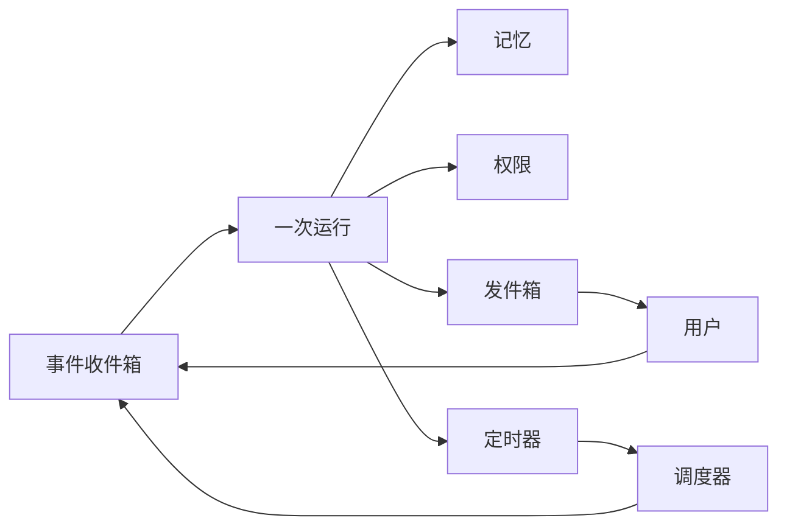

2026-11-14 · thinking

本文挂在 [thinking](/tags/thinking/)。原文发布于 2026-11-13。

> 本文是对 Anthropic 官方文章《Building always-on agents》（作者 William Hu，2026 年 11 月 13 日）的梳理与评述。原文链接：<https://claude.com/resources/articles/building-always-on-agents>。文中凡属原文的论断，均按原文转述；"我认为"之后的内容是我自己的判断，与原文无关。

过去几个月里，常驻 Agent（Always-on Agent）重新成为一个被反复讨论的方向。与一问一答式的对话 Agent 不同，它有状态，也会主动行动：能够跨会话管理上下文，并在没有人直接监督的情况下执行动作。

这一轮回潮有两个直接原因。其一，新一代模型的判断力有所提升，更可靠地理解用户意图，也更清楚什么时候应该停下来确认。其二，推理成本在下降，而长程任务从中受益最多。原文给出的一组数据是：在某个长程编码基准上，Opus 5.5 解决单个任务的成本比 Opus 5 低 78%，而在常规负载上这一降幅是 40%。这意味着，需要连续跑很久才能出结果的任务，第一次在成本上变得可以接受。

然而，模型变强只解决了"敢不敢让它自己跑"的一半问题。另一半是工程问题：Agent 何时被唤醒，两次运行之间什么信息得以保留，结果又如何送到用户手里。这些都不在模型之内，而在模型外围的系统结构里。可以这样概括：模型决定一次运行能做多好，外围架构决定这个 Agent 能不能持续做下去。

原文把这层外围架构拆成五个基础部件：事件收件箱、定时器、记忆、权限和发件箱。下面依次讲清楚每一个部件解决什么问题、怎么搭、边界在哪里，最后再看它们如何闭合成一个循环。

## 一、"常驻"只是用户体验，不是运行方式

先要纠正一个直觉：常驻 Agent 并不是一个一直在跑的进程。

在实际运行中，它大部分时间处于休眠状态，只在被事件触发时醒来工作。原文把每一段工作称为一次运行（Run）：Agent 接收一个事件，完成任务，再把这次发生的事情记录下来。一次运行发生在一个会话（Session）之内，会话是消息和工具调用的完整记录。运行结束后，Agent 回到休眠，这个周期无限重复。

这个定义带来一个重要的设计后果：每一次运行都是短的、可中断的、可重试的，而连续性必须由外围结构来提供，不能指望进程本身一直活着。后面五个部件，本质上都是在回答"连续性放在哪里"。

## 二、事件收件箱：让所有触发源先排队，再被处理

多数 Agent 只在用户发来消息时才运行。常驻 Agent 的触发源要多得多，包括 Webhook、定时任务和后台作业。

最直接的做法，是让每个事件源直接调用 Agent。原文指出这种做法至少有两种失败模式：两个事件同时到达，会启动两个互相竞争的运行；一次崩溃，则可能让某个事件彻底丢失。

收件箱（Event Inbox）的思路是在事件源与 Agent 之间加一层持久化的缓冲：事件源不再调用 Agent，而是把事件写进收件箱，由一个 worker 取出处理。最简版本由三部分构成：

- 一份持久的事件列表，通常是一张数据库表；
- 一个处理器（Handler），通常是一个 HTTP 端点，负责把事件写入列表；
- 一个 worker，通常是一个后台服务，负责从列表里读取事件。

收件箱需要记录每条事件的状态，并可以根据事件源提供的唯一标识去重。原文推荐用关系型数据库，每个事件追加为新的一行，并建议从"每个用户一个收件箱"起步，需要更高并行度时再继续拆分。

处理流程是这样的：新事件到来时，处理器写入收件箱并唤醒 worker；worker 读取所有待处理事件，启动一次运行。延续既有工作的事件，例如用户的回复，会恢复原来的会话；其余事件则开启新会话。随后 worker 把事件交给 Agent 循环，等待运行结束，再把对应事件标记为完成。

细节上，原文给出四条经验，每一条都对应一个具体的故障场景：

1. **处理器要快速确认。** Webhook 提供方往往把慢响应视为失败。处理器可以做轻量检查，但提示注入检测这类较深的校验，应放到运行过程中去做。
2. **收件箱是唯一的事实来源。** worker 被唤醒后，应先从收件箱拉取最新事件。这样即使 worker 在运行中途崩溃，新的 worker 也能接手同一个事件并重试。
3. **同一时刻只允许一个活跃 worker。** 这可以避免两次运行重复劳动，或互相覆盖结果。运行期间又来了新事件，可以有三种处理：推迟到下一次运行、并入当前运行、或者中断后重启。
4. **worker 应当批量处理待办事件。** 例如用户连续发了几条消息，worker 可以把它们合并成一次运行，Agent 只需要回复一次。

我认为，第二条是整套设计里最关键的一条。只要收件箱是事实来源，worker 就可以被当作无状态、可替换的组件；崩溃恢复、重试和多实例部署的复杂度，也都随之下降。

  
事实来源

  

    worker 可以换掉。收件箱不能换。崩溃之后能重试，是因为那一行还在表里，不是因为进程还活着。
  

## 三、定时器：让 Agent 在没有人说话的时候也能行动

收件箱解决的是"被动接收"，主动性则来自定时器（Timers）。原文把定时器分成两类：

- **跟进（Follow-up）**：Agent 为自己设定的截止点，例如"两天后回来看对方有没有回复"；
- **计划（Schedule）**：按已知节奏重复发生的任务，例如每天早上生成一份简报。

两者可以共用相近的表结构，但计划还需要额外记录重复规则。定时器应当放在独立的持久化存储里，通常是另一张数据库表，不与收件箱混放。原因在于收件箱只应该保存"已经可以处理"的事件，而一个三天后才到期的跟进，不属于这个范围。

定时器本身不会启动运行。真正驱动它的是调度器（Scheduler），通常是一个按固定间隔轮询的后台服务。每一轮，调度器依次完成三件事：

1. 扫描存储，找出已到期的定时器；
2. 按类别更新定时器：跟进标记为完成，计划则把到期时间推进到下一次发生的时刻；
3. 向收件箱写入一条事件，并唤醒 worker。

可以看到，定时器最终仍然汇入同一条入口。这样一来，不论事件来自用户、Webhook 还是时钟，Agent 看到的都是同一种东西，运行时不必区分来源。调度器本身，既可以自行实现，也可以交给一个持久执行引擎（Durable Execution Engine）。

## 四、记忆：跨越互不相连的运行，保持连续

常驻 Agent 的每次运行彼此割裂，连续性只能依靠记忆（Memory）。和收件箱、定时器一样，记忆也要有自己的存储。在 Anthropic 的产品里，例如 Claude Code 的自动记忆和 Messages API 的记忆工具，记忆被实现为一个文件目录。对常驻 Agent 而言，这个目录应当映射到持久化存储，通常是数据库或对象存储，使记忆的寿命长于 worker。

原文给出了一条经验法则：记忆只保存 Agent 无法重新查到的信息。如果某件事已经存在于别的系统里，比如问题跟踪系统，就保存一个指向它的指针，而不是复制一份内容。按这个原则，原文建议保存四类记忆：

| 类型 | 内容 | 加载方式 |
|---|---|---|
| 用户指令 | 用户对 Agent 行为的要求 | 单独成文件，每次运行开始时加载。用户不会总在场，指令必须能跨运行延续 |
| 用户笔记 | Agent 了解到的用户角色、偏好和纠正 | 起步一个文件，变多后拆成多个小文件；只加载索引，需要时再按需读取 |
| 历史消息 | Agent 已经对用户说过什么，避免重复 | 单独成文件并在运行开始时加载，或由 worker 读取最近几条消息 |
| 任务进度 | 每个进行中任务已完成和待完成的部分 | 每个任务一个进度文件；同样只加载索引。新的运行读到它，就能接着上一次继续 |

以上讲的都是运行过程中写入的记忆。此外还可以加入"做梦"（Dreaming）机制：回顾过往会话，整理和修订记忆，替换过时的条目，并找出只有跨越多次运行才能看到的规律。

### 上下文窗口里装什么

每次运行开始之前，Agent 会先加载系统提示词、工具定义和记忆文件。这部分初始开销每次都要付，因此原文建议保持精简，并配合提示缓存（Prompt Caching）降低成本。新会话只携带这部分开销和触发本次运行的事件；已有会话则会带回此前各次运行的消息和工具调用。

会话变得过长时，可以压缩较早的消息，或者开启新会话。两种做法都会丢失细节，所以需要长期保留的信息，应当在运行途中就写入记忆。这一点可以视为记忆设计的底线：会话可以丢，记忆不能丢。

## 五、权限：无人值守的系统风险最集中的地方

在五个部件中，权限（Permissions）承载的风险最大。一次运行持有用户的访问权限，而按设计又是无人看管的。对每一次工具调用，Agent 都要判断：自行执行、拒绝，还是等待批准。

原文列出三个构件，其中前两个与其他 Agent 通用：

**凭据存储（Credential Store）。** 常驻 Agent 要有用，往往需要密码、访问令牌这类敏感凭据。推荐的做法是在 Agent 的运行环境之外部署一个代理：Agent 发出不带凭据的请求，代理在转发之前注入真实凭据。这样，即使 Agent 被诱导，也拿不到凭据本身。

**自动模式（Auto Mode）。** 常驻 Agent 必须能在没有持续用户输入的情况下工作。Claude Code 的自动模式用分类器审查风险较高的动作，拦截被判定为危险的那些，让模型转而寻找更安全的路径。不过原文也明确说明：最重要的决策，仍然需要用户来审阅。

**延迟的工具调用（Deferred Tool Calls）。** 在 Claude Code 里，钩子可以把一次工具调用挂起，等待用户进一步输入。同样的模式适用于常驻 Agent。具体流程是：调用被延迟时，本次运行结束，会话在调用中途被保存；请求通过某种界面呈现给用户，例如用 MCP Apps 构建的交互卡片；用户的答复作为一条事件回到收件箱；这条事件启动新的运行，恢复被保存的会话，并带着用户的输入继续。在等待期间，worker 可以去处理其他事件，Agent 不会因此被阻塞。

这套流程与前面几个部件是自洽的：等待审批没有引入任何新机制，它只是"运行结束"加上"一条新事件"。

## 六、发件箱：结果如何送达，以及送多少

对话式 Agent 通常把回复边生成边流式推给用户，用户可以看着它推理、调用工具、写出答案。常驻 Agent 的大部分工作发生在后台，用户拿到的是结果和少量细节，而不是完整的步骤。

一次运行有三种结束方式：向发件箱发送一条消息；判断无需发送任何消息；或者通过延迟的工具调用请求权限与补充信息。

对大多数常驻 Agent，一个直接把消息发给用户的 `send` 工具已经够用。只有在需要控制消息节奏，或需要在出错后恢复时，才有必要建立正式的发件箱（Outbox）。它的结构与收件箱对称：一张外发消息表，加一个对应 worker 的分发器（Dispatcher）。分发器读取待发消息，决定投递哪些，并发送给用户。延迟工具调用产生的请求，既可以经过发件箱，也可以直接显示在界面上。

在投递之外，还有一件更难的事：控制 Agent 发多少消息。发得太多，Agent 会变得嘈杂；发得太少，又会漏掉用户需要知道的事。原文建议为此建立评测（Evals）来寻找平衡点，并给出一条实践倾向：让 Agent 从安静开始，再逐步争取用户更多的注意力。

我认为，这条建议背后的逻辑是不对称的：打扰用户的代价会立刻出现，而漏报的代价往往延后才暴露，所以起点应当偏向前者更小的一侧。

## 七、五个部件如何闭合成循环

把五个部件放在一起，一次完整的运行是这样的。

每次运行都从收件箱里的一个事件开始，无论它是用户消息、Webhook 还是定时器。worker 取到事件后启动运行，在新的或既有的会话里唤醒 Agent。Agent 读取记忆建立基线，在权限范围内执行动作，再把新了解到的内容写回记忆。运行结束后，Agent 向发件箱写入一行，由分发器把消息送到用户手里。

这些环节首尾相连，构成一个循环：一次运行可以设置一个定时器，让 Agent 稍后再次醒来；用户回复消息，答复又作为事件回到收件箱。每一次运行都很短，循环却可以无限继续下去，这就是"一直在线"的体感由来。

## 八、对照我自己的项目

这一节不属于原文，是我拿这套框架回看自己参赛项目 waybill-guardian（异常运单处置 Agent）的结果，只涉及代码里已有的部分。

它并不是一个完整的常驻 Agent，只覆盖了五个部件中的一部分，但对应关系相当清晰：

- **延迟的工具调用。** 三个写操作（改派、理赔、短信）一律先暂停，由 SDK 的暂停与恢复机制承接；人工的决定落盘之后，才恢复同一个 thread。审批状态在 `pending`、`confirmed`、`rejected` 和 `expired` 之间流转，超时默认拒绝。这与原文"保存会话，用户答复作为事件回来，再恢复"的流程一一对应。
- **发件箱。** 回写 TMS 和外发通知，经过一个有界的分发器，带租约续期和确定性重试；对应原文所说的"配速与错误恢复"两个理由。
- **幂等。** 执行身份由服务端从业务参数生成，模型不接触。这一点原文没有展开，但在 worker 可能崩溃重试的前提下，写操作的重复执行是一个必须单独处理的问题。
- **审计。** 每个 run 一份只追加的 JSONL，带哈希链，支持校验和回放。原文没有涉及这一块；我认为在无人值守的前提下，"事后能否复核"和"运行中能否拦截"同样重要，前者弥补的正是后者无法覆盖的部分。

反过来看，定时器和跨运行的记忆是它目前没有做的。如果把项目的定位从"一次异常、一次处置"扩展为"持续盯着所有在途运单"，这两块就是下一步要补的内容。

## 九、边界与保留

最后需要说明几点边界。

第一，原文是一份架构指引，不是实验报告。除开篇的成本数据之外，它没有给出各部件在可靠性、延迟或成本上的量化对比，"从安静开始"之类的建议，也没有对应的评测结果。

第二，原文所述的是一种参考的组合方式，而不是唯一解。它自己也提到，收件箱可以继续拆分，调度器可以换成持久执行引擎，发件箱在多数场景下甚至可以省略。

第三，我自己的对照只是工程层面的类比。waybill-guardian 是一个比赛项目，目前没有经过长时间无人值守运行的检验，上面的对应关系，说明的是结构上的相似，不代表它已经具备原文所描述的全部能力。

回到开头的问题：常驻 Agent 看起来像是一个一直醒着的智能体，实际上是一组让短暂的运行首尾相接的基础设施。模型负责每一次醒来之后做什么，而这五个部件负责它为什么醒、记得什么、能做什么，以及说给谁听。
