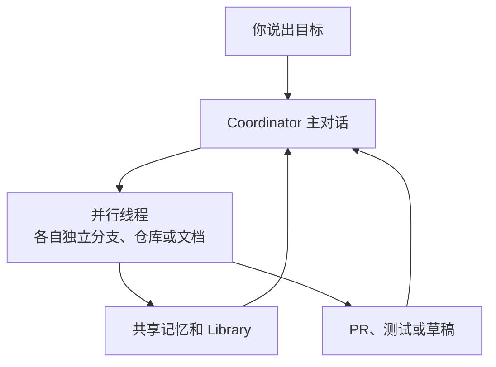
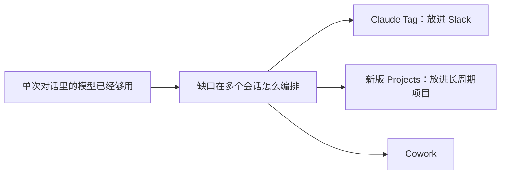

2026-10-21 · 最新速递

本文挂在 [最新速递](/tags/最新速递/)。

## 项目这个概念，正在从文件夹变成对话

2026 年 9 月 17 日，Anthropic 发布了重新设计的 Claude Projects，官方标题叫 from folder to conversation，从文件夹到对话。此前 Projects 是 claude.ai 上一个自包含的工作区：有自己的聊天历史和知识库，你上传文档、写项目指令，然后在里面和 Claude 聚焦对话。新版把它改造成另一种东西：一个项目就是一场对话，你随时说出需要什么，Claude 把工作拆成并行线程放到云端执行，跑完把结果汇合回来。它先在 Claude Code 里以 beta 形态分批开放给 Pro 和 Max 用户，之后会扩展到 chat、Cowork 以及 Team、Enterprise 计划。

| | 旧版 | 新版 |
|-|-|-|
| 形态 | 文件夹：知识库加聊天历史 | 一场对话 |
| 谁拆活 | 你自己分活、交接、拼结果 | Claude 拆成并行线程 |
| 执行 | 在项目里一轮轮问 | 线程在云端并行跑，结果汇合回来 |
| 开放范围 | claude.ai 上的工作区 | 先是 Claude Code beta，Pro / Max 分批 |

## 先回顾一下：Projects 本来是什么

Projects 第一次发布是在 2024 年 6 月，面向 Pro 和 Team 用户，配套当时刚出的 Claude 3.5 Sonnet，每个项目有 200K 上下文窗口，大约相当于一本 500 页的书。它的核心价值是上下文管理：每个项目是独立的知识库加聊天历史，你上传相关文档、代码和资料，Claude 在项目内的所有对话里自动使用这些背景，不用每次重复解释。项目指令（project instructions）可以进一步定制行为，比如要求正式语气、或按某个角色视角回答。

随着时间推移，这块功能补了不少东西。付费计划的项目知识库支持 RAG：当内容接近上下文上限时，Claude 自动切换检索增强生成模式，把容量最多扩展 10 倍。Team 和 Enterprise 计划支持项目分享与协作：项目可以分享给特定成员、批量加人或全组织公开，权限分 Can view（能看能聊不能改）和 Can edit（能改指令、知识、成员和设置）两级，Owner 可以关闭组织内的项目分享。到 2026 年 3 月，官方在解释 Skills 的博客里对 Projects 的定位是：自带聊天历史和知识库的自包含工作区，200K 上下文窗口，知识库内容在所有对话中生效。

| 时间 | 发生了什么 |
|-|-|
| 2024-06 | 首次发布，面向 Pro 和 Team，200K 上下文 |
| 随后 | 付费计划知识库接近上限时切到 RAG，容量最多约 10 倍 |
| Team / Enterprise | 可以分享：Can view 能看能聊，Can edit 能改指令、知识和成员 |
| 2026-03 | Skills 博客里的定位仍是自包含工作区 |
| 2026-09-17 | 重做，标题是 from folder to conversation |

## 新版最大的变化：从你拆活，变成 Claude 拆活

旧版的痛点官方说得直白：一个项目跨多个会话推进时，你要自己分活、自己交接、最后自己把结果拼起来。新版把这套全部收走。在 Claude Code 项目里，你描述目标，Claude 负责范围界定、任务委派、并行线程协调、输出审查和结果组装；你可以在整个过程中从手机端介入指挥，也可以离开电脑让它继续干。

官方给了两个典型例子。一个是设置目标"把应用结账 p75 延迟降下来"，然后让 Claude 逐个接口做性能剖析、并行测试优化方案、直接开 PR。另一个是接上 API、Web、移动端三个仓库，设一个"退役已废弃的 v1 端点"的目标：Claude 为每个仓库开一个线程迁移调用方、跑测试、开 PR，最后告诉你哪些 PR 需要先合并。也就是说，Claude 从一个回答问题的模型，变成了一套能自主编排多个工作流的系统。

## 架构：线程干活，coordinator 指挥

新版 Projects 的架构值得单独看。底层是两层结构：项目里有干活的线程（threads）和指挥它们的协调器（coordinator）。每个线程都是一次完整的 Claude Code 云会话，在独立分支和独立仓库副本上工作，所以多个线程可以并行推进；如果两个线程改到同一份代码，重叠部分按普通 PR 的合并冲突处理，不搞特殊。线程内部还可以把委派的工作继续拆成更小的片，用 subagents、循环和 workflows 加速大任务。

启动项目时，你选择目标和仓库或上下文，Claude 会先建议几件它马上能捡起来的活，界面上一张卡片列出候选任务和 Start 按钮，你可以一键开多个线程。之后你在主项目对话里像指挥一个 Chief of Staff 一样交代工作，它把任务路由到新建的或已有的线程；也可以钻到单个线程里看细节、纠正方向。接上仓库的线程会开 PR、跑测试；接上文档的线程会读文档、起草内容。

两个线程改到同一处时，不另做一套合并规则，重叠部分按普通 PR 冲突处理。线程里面还可以再拆：subagents、循环和 workflows。

## 上下文随时间积累：共享记忆与资料库

新版项目为长期工作设计，官方原话是：比一次回复更久、并且不止一个部分的工作。关键机制是记忆：每个线程都向同一份项目记忆写入、也从里面读取，Claude 会记住发布挪到了周五、为什么砍掉了某个导出、动 billing 服务前要先找谁确认这类背景，减少对复杂提示词工程的依赖。它还记住你的工作与沟通风格：可以要求它调整多久汇报一次、多久开一个新线程、每次更新多详细。

与记忆配套的是 Library 资料库，收集你加进项目的文件和 Claude 产出的工件（artifacts），方便新工作建立在旧成果之上。界面上能看到一个项目跨一周的样子：右侧是逐条请求开的线程，下面不断累积记忆、决策和结果。

## 你还需要知道的三件事

第一，旧项目不会丢。已经开始迁移的 Pro 和 Max 用户，项目里的指令、文件、完整聊天历史和定时任务都会一并带过去，30 天内用过的项目会先收到邮件通知。第二，用量按套餐正常扣除，但因为多个线程同时跑、每个线程都是一个完整 Claude Code 会话，项目会更快到达用量上限；官方提供项目级用量查看，并且可以分别为 coordinator 对话和 worker 线程选择模型和 effort 级别。第三，目前线程跑在云端，官方明确"在你的机器上、跟你的本地工具和代码一起、在你自己的网络后面运行"即将推出。对敏感代码和数据来说，这条本地运行的能力会是很多人等新版的理由。

| | 迁移 | 用量 | 跑在哪里 |
|-|-|-|-|
| 现在 | 指令、文件、聊天记录和定时任务一起带走 | 按套餐扣，多线程更快到上限 | 线程在云端 |
| 细节 | 30 天内用过的项目先收到邮件 | coordinator 和 worker 可以分开选模型与 effort | 在本机、跟本地工具一起跑，即将推出 |

## 它解决的是 Agent 协作里的什么问题

把新版 Projects 和 Claude Tag、Cowork 放在一起看，Anthropic 的产品线其实在围绕同一个趋势收拢：单个对话里的模型已经够强，瓶颈变成了多个会话之间的编排。Claude Tag 把这种能力放进 Slack 频道，新版 Projects 把它放进一个长周期项目。旧版 Projects 回答的是"怎么让每次对话都知道背景"，新版回答的是"怎么让一堆对话像一个团队那样协作"。你不再需要把工作拆好喂给模型，而是描述结果，让模型自己拆、自己并行、自己合并——这是从工具到协作者的一步，也是它和之前我们聊过的那些 Agent 产品共享的设计方向。

## 参考来源

- Anthropic 官方博客《Projects redesigned: from folder to conversation》（2026-09-17）
- Claude Help Center《What are projects?》（2026-10 更新）
- Anthropic 新闻《Collaborate with Claude on Projects》（2024-06-25）
- 官方博客《Skills explained》（2026-03-05）
