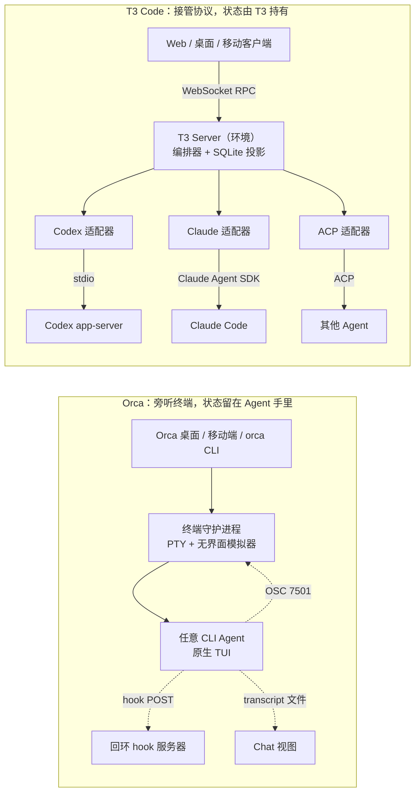
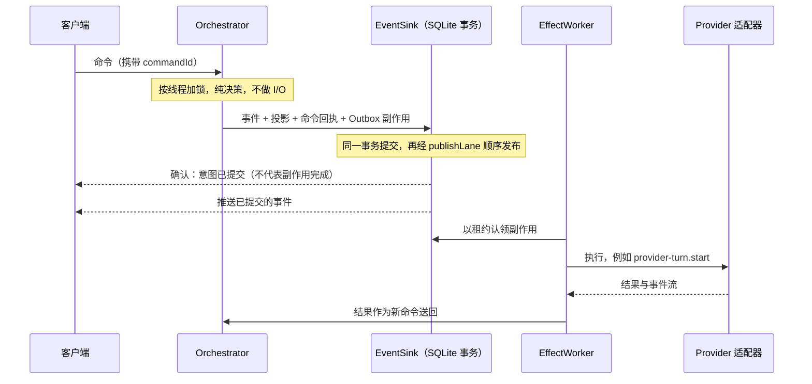
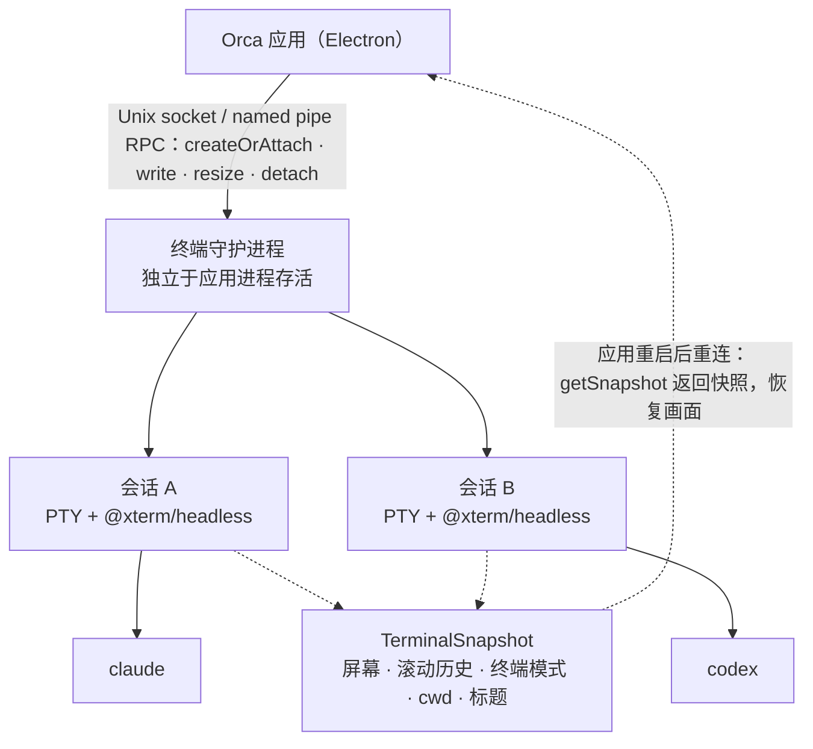
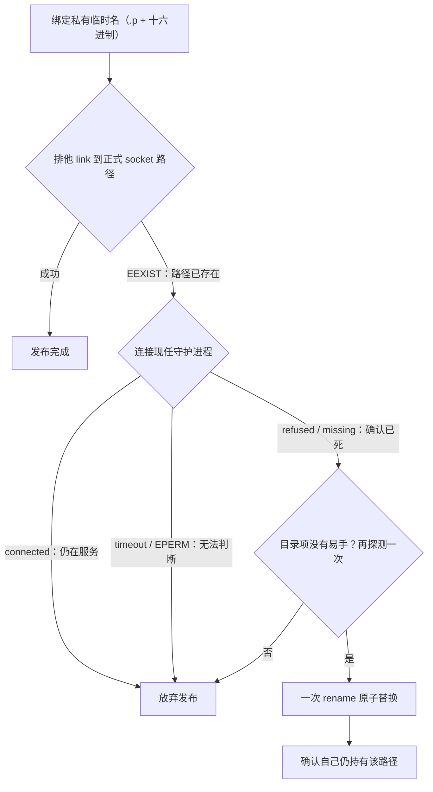
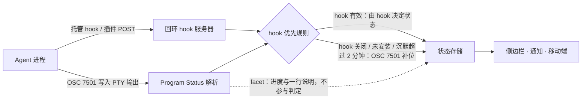

<strong>拆解说明</strong>｜这是 [Agent 拆解专栏](/posts/agent-breakdown/) 的一篇。对象是 [`pingdotgg/t3code`](https://github.com/pingdotgg/t3code) 和 [`stablyai/orca`](https://github.com/stablyai/orca)，源码口径为 2026-11-26 的 `main` 分支。

过去一年里，Claude Code、Codex 这一类 Coding Agent 已经证明，单个 Agent 可以在较少人工干预的情况下完成一段完整的开发任务。开发者的角色也随之上移：从逐行编写代码，转向分派任务、审阅结果和处理 Agent 提出的审批。

然而，Agent 的原生形态是一个终端里的 CLI 进程。当同时运行的 Agent 从一个变成五个、十个，并且分布在本机、远程主机和不同的 Git worktree 上时，“开一个终端窗口跑一个 Agent”的模式很快就会失效。开发者需要知道哪个 Agent 在工作、哪个在等待审批、哪个已经结束，也需要在离开电脑之后继续推进这些任务。在这种模式下，单个 Agent 的上限取决于模型能力，多个 Agent 的上限取决于控制台的能力。

最近一段时间，我把日常的大部分 Agent 工作放在了 T3 Code（[pingdotgg/t3code](https://github.com/pingdotgg/t3code)）和 Orca（[stablyai/orca](https://github.com/stablyai/orca)）上。两者都开源、都采用 MIT 许可、都主张“自带订阅”，也都覆盖桌面、Web 或移动端。然而在深度使用之后，我发现两者的手感差异很大，于是又去读了两边的源码，想弄清楚这些差异从何而来。本文是我深度使用加源码阅读之后的整理与思考。

需要先说明边界：文中引用的源码细节取自 2026 年 11 月 26 日两个仓库的 `main` 分支。两个项目的迭代速度都很快，文件名、常量和数字可能很快就会变化，因此仅作为理解设计思路的参考。

## 一、两条路线

具体来说，两个项目对同一个问题给出了方向相反的答案：<strong>会话状态应该由谁持有？</strong>

T3 Code 的答案是由自己持有。它的定位是“a minimal GUI for coding agents”，核心是一个 Node WebSocket 服务器。这个服务器通过各家 Agent 的结构化协议接管它们：Codex 走 app-server 的 stdio 协议（`packages/effect-codex-app-server`），Claude Code 走官方的 Claude Agent SDK（`@anthropic-ai/claude-agent-sdk`），其他 Agent 优先走 ACP（Agent Client Protocol）。Agent 产生的每一条消息、每一次工具调用和每一个审批请求，都会被翻译成 T3 Code 自己的领域事件，并持久化到 SQLite 中。

Orca 的答案正好相反，会话状态留在 Agent 自己手里。它的 README 写得很直接：“Works with any CLI agent — if it runs in a terminal, it runs in Orca.” Orca 把每个 Agent 当作一个跑在伪终端（PTY）里的普通 CLI 进程，自己则作为一个“旁听者”，通过 Agent 的 hook、终端控制序列和 Agent 写在磁盘上的 transcript 文件，推断这个 Agent 正在做什么。

这两种选择决定了后面几乎所有的工程问题。T3 Code 需要解决的是“如何把多个异构协议收敛成一个一致的状态机”，Orca 需要解决的是“如何从一个不透明的终端进程中可靠地读出状态”。前者的难点在于一致性，后者的难点在于可观测性。

图 1　两条路线：T3 Code 通过结构化协议接管 Agent，Orca 让 Agent 跑在终端里并旁路感知状态

## 二、T3 Code：把一次对话做成事件溯源系统

### 2.1 进程边界：执行永远留在拥有工作区的那台机器上

T3 Code 的架构文档（`docs/internals/01_architecture.md`）开宗明义地划定了一条边界：执行发生在拥有工作区的环境（Environment）中，Web、桌面和移动客户端只通过经过认证的 RPC 控制它。远程客户端不能用自己的文件系统、凭据或机器状态替代环境的状态。桌面端虽然是一个内置了服务器的 Electron 应用，但它的渲染进程同样遵守这条边界。

围绕这条边界，仓库被拆成几个职责清晰的部分：`apps/server` 持有 provider 进程、终端、Git、checkpoint 和持久化状态；`packages/contracts` 定义客户端与服务器之间的类型化线协议，允许两者独立发版；`packages/client-runtime` 统一管理 Web、桌面和移动端的连接与领域状态；`packages/provider-*` 则把各家 Agent 的协议细节封装在适配器之后。整个服务端基于 Effect-TS 构建，每个功能都是一个 `Context.Service`，错误统一用 `Schema.TaggedError` 建模。

我认为这条边界是 T3 Code“远程优先”体验的基础。正因为客户端从不持有执行权，手机、浏览器和另一台电脑连上同一个环境时，看到的才是同一份事实，而不是各自的副本。

### 2.2 编排核心：命令、事件、投影与 Outbox

T3 Code 的编排层（`apps/server/src/orchestration-v2/`）是我读过的 Agent 应用中，最接近传统后端系统设计的一个。它借鉴了事件溯源（Event Sourcing）和事务性发件箱（Transactional Outbox）两种经典模式，把一次用户与 Agent 的交互拆成了四个环节。

第一个环节是<strong>决策</strong>。`Orchestrator.ts`（单文件约一万一千行）负责接收命令，并根据当前状态决定应当产生哪些事件。这一步被严格要求不做任何 I/O。同一个线程上的命令通过 `KeyedLock<ThreadId>` 串行化，不同线程之间则可以并行处理。

第二个环节是<strong>提交</strong>。`EventSink.ts` 在同一个数据库事务中提交四样东西：领域事件、持久化投影（Projection）、命令回执（Command Receipt）和待执行的副作用（Outbox Effect）。命令回执用于让客户端重试具备幂等性；副作用则是“开始一个 provider turn”“捕获一个 checkpoint”这类需要在事务之外执行的意图。提交完成之后，事件再通过一个容量为 1 的信号量（`publishLane`）按顺序发布给订阅者。源码注释给出了这个设计的理由：“reordered publication makes clients drop earlier sequences”，也就是说，发布顺序一旦错乱，客户端就会丢弃较早的序号。

第三个环节是<strong>执行</strong>。`EffectWorker.ts` 以租约（Lease）的方式从 outbox 中认领副作用并执行。`EffectOutbox.ts` 中定义的副作用类型包括 `provider-turn.start`、`provider-turn.interrupt`、`provider-turn.steer`、`runtime-request.respond`、`checkpoint.capture` 等十余种。执行结果不会直接修改状态，而是作为新的命令重新送回编排器。

第四个环节是<strong>恢复</strong>。服务器重启之后，与已经丢失的 provider 进程绑定的副作用会被直接退役，而不是被重放。原因在于，向一个已经不存在的进程重放“开始一个 turn”，得到的只会是一个错误的状态。

这套拆法带来了一个重要的语义：命令被接受，只代表意图已经提交，不代表 provider 或 checkpoint 的工作已经完成。架构文档对此有明确的约束：“Never put external I/O in command decisions or the database transaction.” 在这种模式下，决策是纯函数，提交是原子的，副作用是可追踪、可退役的。

  
面试点

  

    事务性发件箱要解决的就是双写：数据库写成功、消息没发出去。把副作用当成一行数据和事件一起提交，worker 再按租约去捞，崩溃也只会让它多捞一次，所以执行端还得幂等。
  

图 2　T3 Code 一条命令的生命周期：决策、提交、执行、回灌

当然，T3 Code 并没有采用完整的事件溯源。文档明确写道，事件日志只保留一个有界的回放窗口，因此投影无法从日志从头重建，投影本身才是事实源。从我的理解来看，这是一个务实的权衡：完整的事件溯源需要永久保存全部历史，而一个桌面应用的磁盘和启动时间都承受不起这样的代价。

### 2.3 适配器：只声明协议真正支持的能力

所有 provider 的差异都被收敛到 `packages/provider-core/src/server/ProviderAdapter.ts` 定义的 `ProviderAdapterV2` 接口之后。适配器对外输出一个统一的事件流，`ProviderAdapterV2Event` 是一个包含 17 种事件的联合类型，例如 `turn_item.updated`、`runtime_request.updated`、`subagent.updated`、`command_output.delta` 和 `turn.terminal`。在会话层面，适配器必须实现 `steerTurn`、`interruptTurn`、`respondToRuntimeRequest`、`readThreadSnapshot`、`rollbackThread` 和 `forkThread` 等方法；`resumeTurn`、`compactThread`、`stopSubagent` 等能力则是可选的。

这里最值得注意的不是接口本身，而是 `docs/internals/03_providers.md` 中关于“诚实能力”的几条约束：

- 适配器只能声明 provider 真正支持的能力。不支持 fork、rollback 或 steering 的 provider，必须关闭对应的能力位，让编排层优雅降级；能力开着却在运行时失败，被视为 bug。
- 不允许模拟 provider 并不具备的权限模式。T3 Code 不能通过自动回答审批请求来“伪造”一个权限模式；provider 未提供的模式会回退到 Supervised。
- 对于非第一方的 Agent，ACP 集成严格遵守规范，不为某个 Agent 添加厂商扩展或特例分支。如果上游 Agent 偏离了规范，应当由编排层通过能力位降级，而不是在共享适配器里打补丁。

我认为这几条约束本质上是同一个原则：控制台展示给用户的保证，必须与底层协议真正能执行的保证一致。文档的原话是：“A misleading permission guarantee in T3 is a T3 bug.”

文档还记录了几个“踩过不止一次”的跨 provider 陷阱，例如：在 provider 登记 prompt 之前发出 Stop，可能被忽略，也可能让会话卡死，因此取消操作必须等到 provider 的 turn-started 信号之后才能发出；子 Agent 和后台任务可能在 T3 Code 认为 turn 已经结束之后才上报结果，因此子 Agent 的更新必须按子 Agent 路由，而不是按当前活跃的 run 路由。这些细节只有在把多个真实 Agent 接入同一个状态机之后才会暴露出来。

### 2.4 流量控制：不是所有数据都应该进入事件流

事件溯源的一个常见陷阱，是把高频的流式数据也当作事件写入日志。T3 Code 对此做了明确的拆分。

具体来说，终端命令的实时输出不经过编排事件，而是由适配器直接写入 `CommandOutputHub.ts`，客户端只有在展开某一行命令时才会订阅。这个 hub 以 100 毫秒为最小帧间隔推送输出；如果某个订阅者积压的原始文本超过 16 KB，就改为直接发送尾部内容；同时最多保留 64 条活跃命令。性能文档对此给出的理由是：“a busy command would flood the event store and stall every thread”，即一个输出繁忙的命令会淹没事件存储，并拖慢所有线程。与此同时，`ThreadLiveEventCoalescer.ts` 会在 50 毫秒的窗口内合并同一实体的更新，并保持每条幸存更新的原始序号，以免恢复游标跳过无关的早期更新。

这种对线上流量的克制，在 T3 Code 中是被 CI 强制执行的。仓库中有一组线程载荷预算测试（`transferBudgetV2.integration.test.ts`），会在 PR 上报告冷启动、历史分页和断线续传各自传输了多少字节。服务端还有一套性能基准：它让真实的 `claude` CLI 对接一个伪造的 Anthropic API，测量 CPU、唤醒次数、内存和首请求延迟，并以 A B、B A 交替的方式对比两个版本，让机器负载的漂移同时落在两侧。在这种模式下，“流畅”不再是一种主观感受，而是一组可以被回归测试守住的数字。

### 2.5 Checkpoint：不往用户分支上写一个提交

T3 Code 的每个 turn 结束后都会捕获一次 checkpoint，用于展示 diff 和回滚。这些 checkpoint 存储在隐藏的 Git ref 中，前缀是 `refs/t3/orchestration-v2/checkpoints`，因此不会在用户的分支上增加任何提交。

与此同时，架构文档把“provider 的 turn 结束”和“后续工作落定”区分为两个独立的里程碑。一个 run 在 provider turn 结束时就被标记为 `completed`，而 checkpoint 的捕获作为一个 outbox 副作用随后执行。在捕获提交之前，编排器依然把这个 run 视为 `waiting`，因此用户在此期间发出的追加消息、排队的 turn 和回滚操作，都会排在 checkpoint 之后执行。回滚还有一条额外的规则：如果 provider 无法回滚自己的对话，就必须在修改文件之前拒绝这次回滚。否则，工作区回到了过去，Agent 的记忆却还停留在现在。

## 三、Orca：把终端做成可观测、可续命的运行时

### 3.1 技术栈与形态

Orca 是一个基于 Electron 45、React 19、xterm.js 6 和 node-pty 构建的桌面应用，状态管理使用 zustand，构建使用 electron-vite，类型检查已经切换到 TypeScript 7。与 T3 Code 相比，Orca 的功能面要宽得多：并行 worktree、分屏、内置浏览器与设计模式、diff 批注、GitHub 和 Linear 集成、SSH 与 WSL 远程、移动端，以及可以从 Slack、Linear 和 GitHub 触发的 Bots。

然而，在这些功能之下，Orca 的核心抽象始终是终端。Agent 以原生 CLI 的形式运行在 PTY 中，用户看到的是 Agent 自己绘制的 TUI，而不是一个重新渲染的聊天界面。即使是后来加入的 Chat 模式，也允许同一段对话在 Chat 界面和原始 CLI 之间切换。

### 3.2 终端守护进程：让 PTY 活得比窗口更久

把 Agent 放在终端里，第一个问题是终端的生命周期。如果 PTY 由 Electron 主进程直接持有，那么应用一旦重启或更新，所有正在运行的 Agent 都会随之退出。

Orca 的做法是把 PTY 放进一个独立的终端守护进程（`src/main/daemon/`）。守护进程通过 Unix socket（Windows 上是 named pipe）对外提供 RPC，协议定义在 `daemon-rpc-contract.ts` 中，包括 `createOrAttach`、`write`、`resize`、`pausePty`、`resumePty`、`detach`、`getSnapshot` 和 `takePendingOutput` 等请求。会话状态被建模为 `created → spawning → running → exiting → exited` 五个阶段。

仅仅让进程存活还不够，重新连接的客户端还需要看到断开之前的屏幕。为此，守护进程为每个会话维护一个无界面的终端模拟器（`emulation/headless-emulator.ts`），基于 `@xterm/headless` 和 `SerializeAddon` 持续解析 PTY 输出。客户端重新挂载时，守护进程返回一个 `TerminalSnapshot`，其中包括当前屏幕的 ANSI 序列、备用缓冲区（Alternate Buffer）激活时单独保存的普通缓冲区滚动历史、终端模式、光标状态、工作目录、窗口标题，以及一段尚未解析完的转义序列尾部（`pendingEscapeTailAnsi`）。这种做法与 tmux 的思路相似：终端的真实状态保存在服务端，客户端只是一个可以随时断开和重连的视图。

图 3　Orca 的终端守护进程：PTY 独立于应用存活，重连时用快照恢复画面

### 3.3 一个 socket 路径上的并发问题

守护进程目录下有一份单独的 `AGENTS.md`，记录了一个非常典型的分布式问题：<strong>谁有权修改守护进程的 socket 路径？</strong>

问题的起因是 Node 的 `net.Server.close()` 会在不做任何所有权检查的情况下删除它绑定的路径。于是，一个正在退出的旧守护进程，可能会删掉恰好占据同一路径的新守护进程的 socket。新守护进程依然存活，依然托管着所有 PTY，却再也没有客户端能够连上它。在用户看来，现象就是终端能接受键盘输入，但命令永远不会执行。

文档坦白地记录了修复的过程：针对旧的“由启动器回收死进程路径”的方案，团队进行了七轮评审，发现了二十三个缺陷，而这些缺陷都是同一种交错：第三方在 T 时刻观察到存活状态，在 T+1 时刻对目录项采取行动。最终的协议（`daemon-endpoint-ownership.ts`）是：先绑定一个私有的 `.p<hex>` 临时名称，再尝试一次排他的 `link`；如果返回 `EEXIST`，就通过连接来证明现任者已经死亡，再确认目录项没有易手，再探测一次，最后用一次 `rename` 系统调用完成替换。文档提到，在实际交接过程中，“先 `unlink` 再 `link`”的做法几乎每次观测都会出现路径缺失的空窗，而 `rename` 在约 14,500 次探测中一次都没有。

图 4　守护进程发布 socket 路径的所有权协议：无法判断时一律放弃

文档中有一条规则，我认为值得所有写进程管理代码的人记住：“Never collapse 'can't tell' into 'dead.'” 只有连接成功才能证明路径被占用，只有 `refused` 或 `missing` 才能证明进程已死；超时或 `EPERM` 什么也证明不了，只能放弃操作。

  
我会抄走的一条

  

    kill -0 返回 EPERM、connect 超时，都很容易被顺手写成“进程没了”。三态判断（活、死、不知道）比二值多一个分支，省掉的是一类只在生产上出现的偶发事故。
  

### 3.4 状态感知：hook 为主，终端协议兜底

把 Agent 放在终端里的第二个问题，是如何知道它在做什么。Orca 的 `src/main/agent-hooks/README.md` 描述了两条并行的通道。

第一条通道是<strong>托管集成</strong>。Orca 为每一种支持的 Agent 安装 hook、插件或扩展，这些 hook 会把事件 POST 到本机回环地址上的 hook 服务器。这条通道信息最丰富，携带状态、prompt、工具名与工具输入、Assistant 回复、模型、子 Agent，以及 provider 的 session id。session id 尤其关键，Orca 的会话恢复和 Chat 模式都依赖它。

第二条通道是 <strong>OSC 7501</strong>，也就是 Program Status Protocol。Agent 把自己的状态以终端控制序列的形式写进 PTY 输出流，Orca 从输出中解析它，并应答协议的 `?` 探测。根据 README 中截至 2026 年 11 月 17 日的支持矩阵，Claude Code 从 2.1.295 版本开始支持这一协议，Grok、pi、Codex、Kimi Code 等 Agent 也已经实测支持；OpenCode、Cursor、Amp 等 Agent 则尚未支持。

两条通道之间有明确的优先级：hook 优先，OSC 7501 填补 hook 没有覆盖的地方。具体包括 hook 被关闭、hook 未安装（例如一台新的 SSH 主机或用户手动启动的 Agent）、程序完全没有集成，以及 hook 在某个状态上沉默了两分钟、而程序已经离开该状态的情况。即使 hook 掌握状态，OSC 7501 的报告也会作为一个附加的 facet 显示进度和一行说明，但它永远不参与状态判定。

图 5　Orca 的状态感知：hook 为主，OSC 7501 兜底并以 facet 补充

那么，Agent 都支持 OSC 7501 之后，hook 是否就可以退场？文档的回答是否定的：OSC 7501 没有字段承载 prompt、工具输入、Assistant 回复、模型和 session id，而 Chat 模式、会话恢复、侧边栏预览和通知文案都需要这些数据。

hook 通道还承担了一部分拦截能力。对于 Claude Code 的 PreToolUse 事件，Orca 的 POSIX hook 脚本会等待 Orca 的回复，最多等待 8 秒，而 Orca 保证在 6 秒内应答；回复可以是拒绝，也可以是修改后的工具输入。如果超时、出错或 Orca 没有运行，脚本就输出 `{}`，工具调用照常进行，就像 Orca 不存在一样。这是一个典型的失败开放（Fail-open）设计：控制台可以介入 Agent，但控制台的故障不能卡住 Agent。

  
fail-open 的代价

  

    fail-open 意味着 Orca 没在跑的时候，它的拦截规则也一并失效。拿它当提示层没问题，拿它当安全边界就不够，真要拦得住还得靠 Agent 自己的权限配置。
  

### 3.5 多 Agent 编排：CLI 是 Agent 的操作界面

Orca 的另一条主线，是让 Agent 自己也能操作 Orca。README 的描述是：“Anything you can do in Orca, your agents can do too.” 这条能力的载体是 `orca` CLI。

在本机，CLI 通过 Unix socket 或 named pipe 连接到 Orca 运行时，使用以换行符分隔的 JSON 进行 RPC，并携带认证 token。`src/cli/runtime/connection/transport.ts` 中有一个细节：如果 socket 所在目录不是当前用户私有的，CLI 会拒绝发送 token，以免把凭据交给一个被预先放置在共享 `/tmp` 中的监听者。连接远程运行时的时候，CLI 则改用 WebSocket。

编排相关的状态保存在一个独立的 SQLite 数据库中，当前的 schema 版本是 51，核心表包括 `runs`、`messages`、`deliveries`、`mutation_receipts`、`worker_dispatches` 和 `worker_terminal_resources` 等。从表结构可以看出，Orca 的多 Agent 协作建立在一个邮箱（Mailbox）模型之上：领头的 Agent 通过 CLI 启动 worker、发送消息，worker 的回复以投递（Delivery）的形式送回；`mutation_receipts` 则与 T3 Code 的命令回执承担相同的职责，让变更类请求可以安全重试。

`src/main/runtime/orchestration/coordinator/coordinator.ts` 中还有一个基于 DAG 的协调器，它的阶段依次是 `decomposing → dispatching → monitoring → merging → done`，默认每 2 秒轮询一次，最多同时运行 4 个任务。不过，源码注释写明：“Tasks must be pre-created until decomposition is implemented.” 也就是说，自动拆解任务这一步尚未实现。结合 README 的描述，我的理解是，目前的任务拆分主要由领头的 Agent 自己完成，协调器负责的是派发、监控和汇合。

### 3.6 Chat 模式：读 Agent 自己写下的记录

Orca 的 Chat 模式没有像 T3 Code 那样完全接管 Agent 的协议，而是在相当程度上依赖 Agent 自己写在磁盘上的 transcript。`src/main/native-chat/` 下有按 Agent 区分的 transcript 解码器（Claude、Codex、Grok、Antigravity 等）、transcript 监听与尾部读取，以及一个会话日志层 `agent-session-journal`。结合 hook 带回的 provider session id，我的理解是，Orca 正是通过“同一个 provider 会话、两种呈现方式”实现了 Chat 与终端之间的切换。仓库同时依赖 `@anthropic-ai/claude-agent-sdk`，说明 Orca 也在部分场景中使用了结构化的接入方式，但终端依然是它的第一形态。

## 四、对比与取舍

把两个项目放在一起，差异可以归纳为下表。

| 维度 | T3 Code | Orca |
|---|---|---|
| 会话状态的持有者 | T3 Code 自己（SQLite 投影是事实源） | Agent 自己（CLI 进程与其 transcript） |
| Agent 接入方式 | Codex app-server、Claude Agent SDK、ACP 等结构化协议 | 任意 CLI 运行在 PTY 中，hook 与 OSC 7501 旁路感知 |
| 新增一个 Agent 的成本 | 需要一个适配器，或者 Agent 遵守 ACP | 能在终端里运行即可，状态精度取决于集成深度 |
| 状态的可靠性 | 由协议事件直接给出 | 由多通道信号推断，并设计了优先级与降级 |
| 进程存活 | 服务器持有 provider 进程，重启后按能力恢复会话 | 独立守护进程持有 PTY，重连后用快照恢复画面 |
| 用户看到的界面 | 统一重新渲染的对话界面 | Agent 原生 TUI，加可切换的 Chat 视图 |
| 功能面 | 克制，围绕线程、turn、checkpoint 展开 | 宽广，覆盖浏览器、Bots、插件、计算机操作等 |

我认为，这些差异背后是同一个结构性原因：<strong>谁持有会话状态，谁就要为状态的一致性负责。</strong>

T3 Code 选择持有状态，因此它能提供 Orca 很难提供的东西：精确到 turn 的回滚、跨设备完全一致的视图、可以被 CI 量化的线上流量。但它也必须为每一种协议编写适配器，并且只能接入那些提供了结构化协议的 Agent。Orca 选择把状态留给 Agent，因此它可以在第一天支持任何 CLI Agent，并完整保留 Agent 原生 TUI 的全部能力。但它也必须投入大量工程来回答“这个 Agent 现在到底在做什么”，`src/shared/agent-status` 和 `src/shared/agent-hook-listener` 两个目录合计约三百五十个文件，就是这部分成本的体现。简而言之，T3 Code 的上限取决于协议的表达能力，Orca 的上限取决于终端能透出的信号。

值得注意的是，两个项目正在向对方的方向靠拢。T3 Code 引入了 node-pty，支持在线程旁边打开终端；Orca 加入了 Chat 模式，并依赖了 Claude Agent SDK。从我的使用来看，这种趋同是合理的：用户在审阅和审批时需要一个结构化的界面，在 Agent 卡住、需要手动介入时又需要一个原始终端。两者真正的区别不在于是否提供这两种界面，而在于哪一种是系统的事实源。

## 五、两个项目共同教给我的东西

用了这么久、又读完两份代码之后，我印象最深的并不是某个具体的实现，而是两个团队在面对不确定性时的同一种克制。

T3 Code 规定，不能通过自动回答审批来模拟一个 provider 并不具备的权限模式；Orca 规定，不能把“无法判断”当作“已经死亡”。T3 Code 要求适配器只声明协议真正支持的能力；Orca 在 hook 沉默时退回到 OSC 7501，并且让 OSC 7501 只做补充、不做判定。两边的命令回执和变更回执，都是为了让重试不会把一次操作执行两次。这些规则说的都是同一件事：控制台展示给用户的每一个状态，都必须有真实的信号作为依据。

这一点对 Agent 控制台尤其重要。原因在于，开发者之所以愿意同时运行十个 Agent，正是因为他们相信控制台显示的“等待审批”真的在等待审批，“已完成”真的已经完成。一旦这种信任被打破，开发者就会重新回到逐个检查终端的模式，控制台也就失去了存在的意义。控制台的价值不在于展示了多少信息，而在于它展示的每一条信息都可以被信任。

最后需要说明，本文是我作为用户深度使用、并结合源码阅读得出的理解，并非两个项目的官方说明。如果文中有理解偏差，欢迎指正。

---

<em>数据口径：两个仓库的信息均取自 2026 年 11 月 26 日的 `main` 分支。届时 T3 Code 约有 8.0 万 star，其 `AGENTS.md` 自述用户超过 50 万；Orca 约有 13.9 万 star。两者均为 MIT 许可，T3 Code 的商标与品牌不在许可范围之内。</em>
